<p align="center">
  
</p>

<h1 align="center">SandboxLabML</h1>

<p align="center">
  A live machine learning lab in your browser, where you watch neural networks learn to drive an SUV through a city and to run a course to the finish line, in 3D.<br />
  <a href="https://sandboxlabs.vercel.app/">sandboxlabs.vercel.app</a>
</p>

<p align="center">
  <a href="LICENSE"></a>
  
  
</p>

## What it is

SandboxLabML lets you see machine learning happen. Press Train and a population of neural networks starts learning right in front of you. A hundred SUVs learn to follow a route through a city: when to go, when to stop at a red light, when to wait for someone on the crossing and which corner to turn at. A hundred little runners learn to reach a finish line, first on an empty floor and then round crates, through gaps in walls, past spikes and between sliding blocks.

None of it is a canned animation. Every SUV and every runner is driven by a real network that evolved seconds ago, inside a real simulation, on your own machine. Open any brain and its neurons light up as it decides. Change the rewards, the inputs or the brain itself, and the next generation shows you what that change did. Even the home screen plays real brains: a trained SUV drives the city beside a trained runner crossing its courses.

This is the loop that makes machine learning click. You shape the goal and press Train, then watch behavior appear that nobody programmed.

## Screenshots

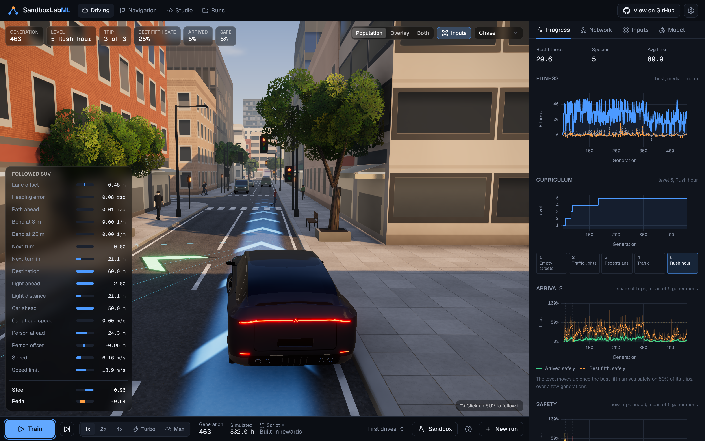

| | |
| --- | --- |
| 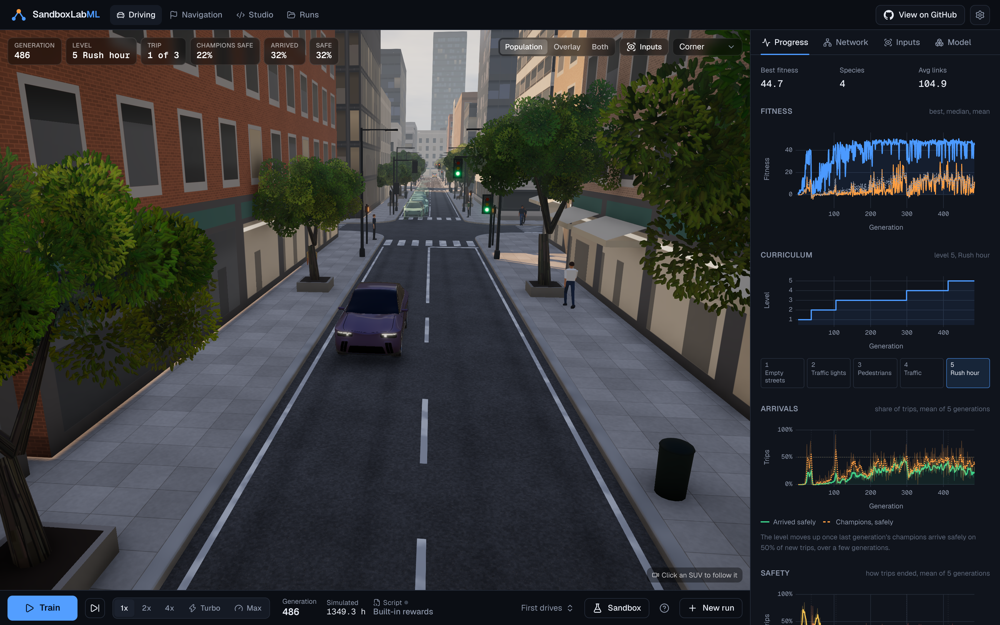 | 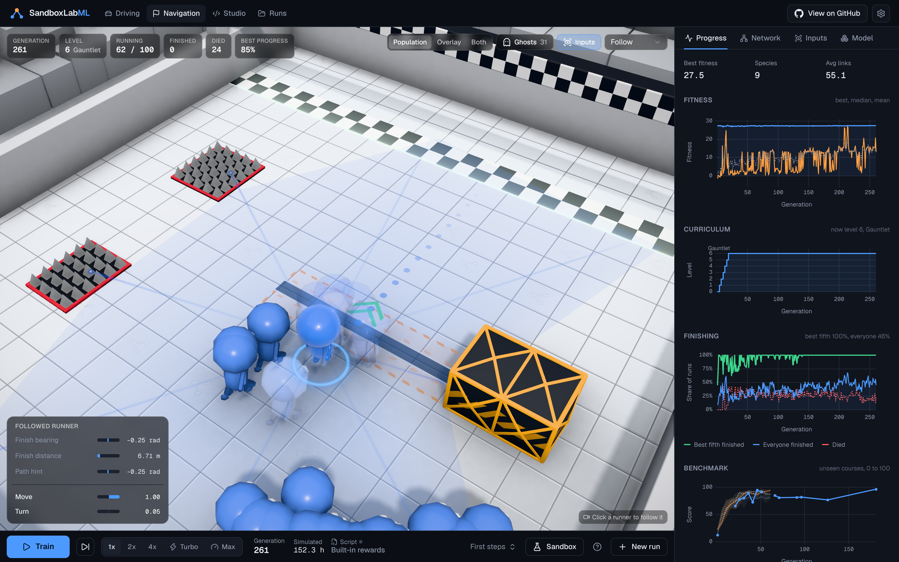 |
| 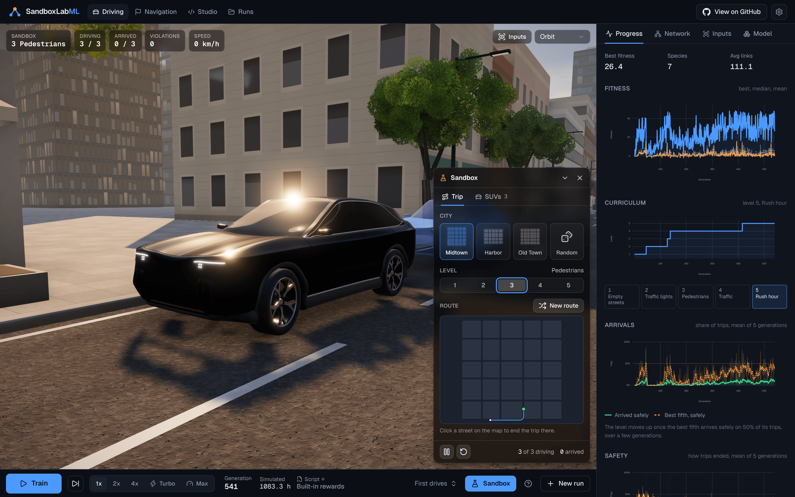 | 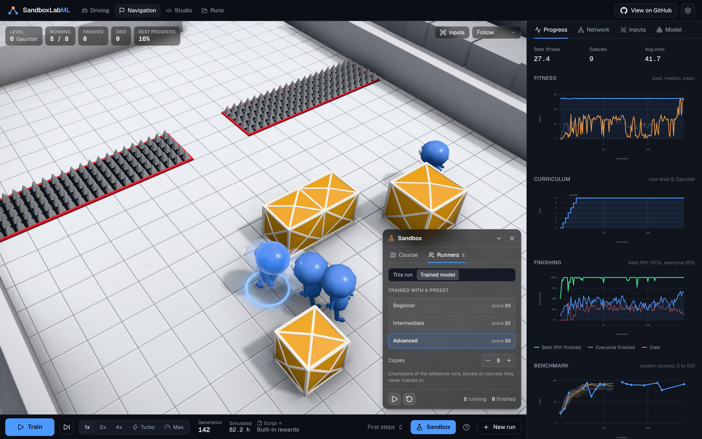 |
| 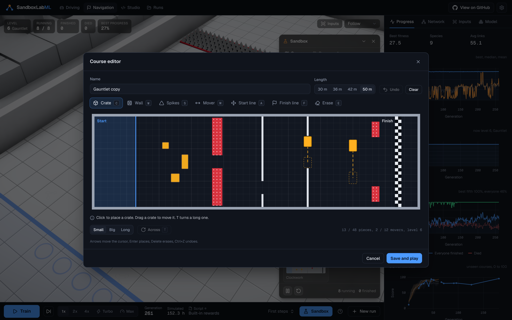 | 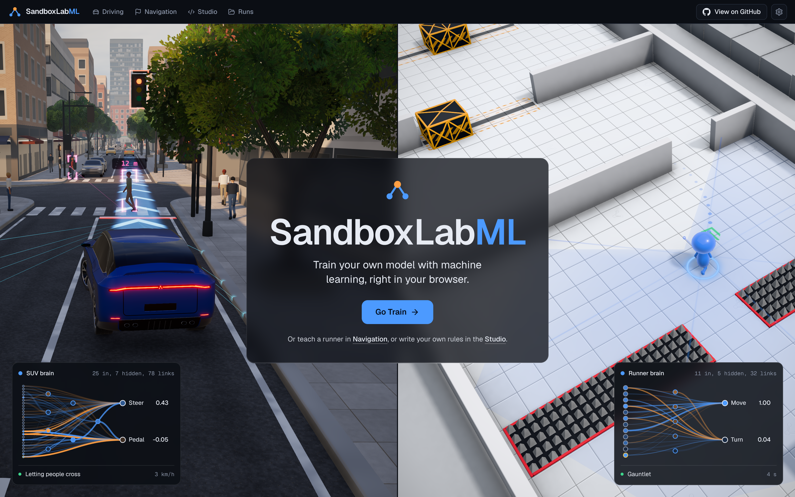 |
| 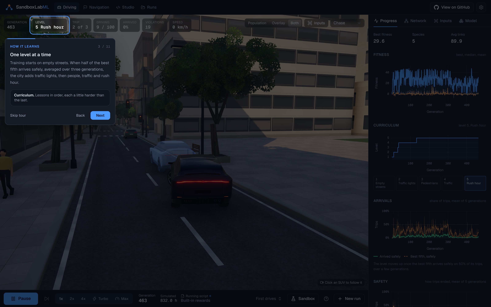 | 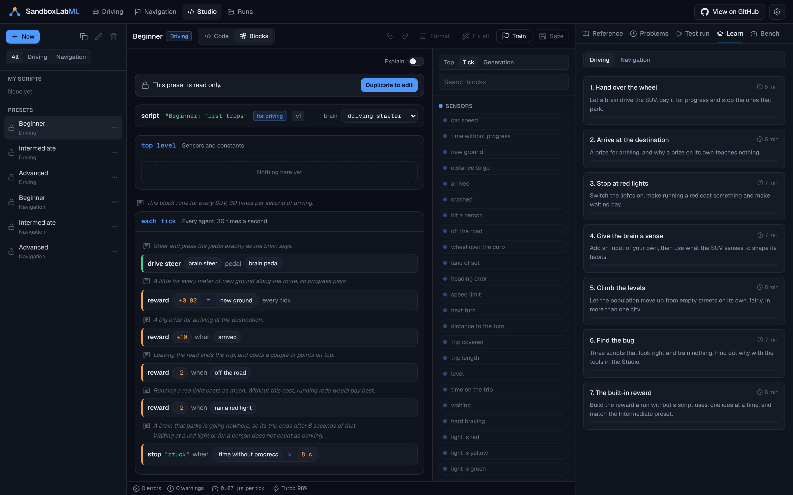 |
| 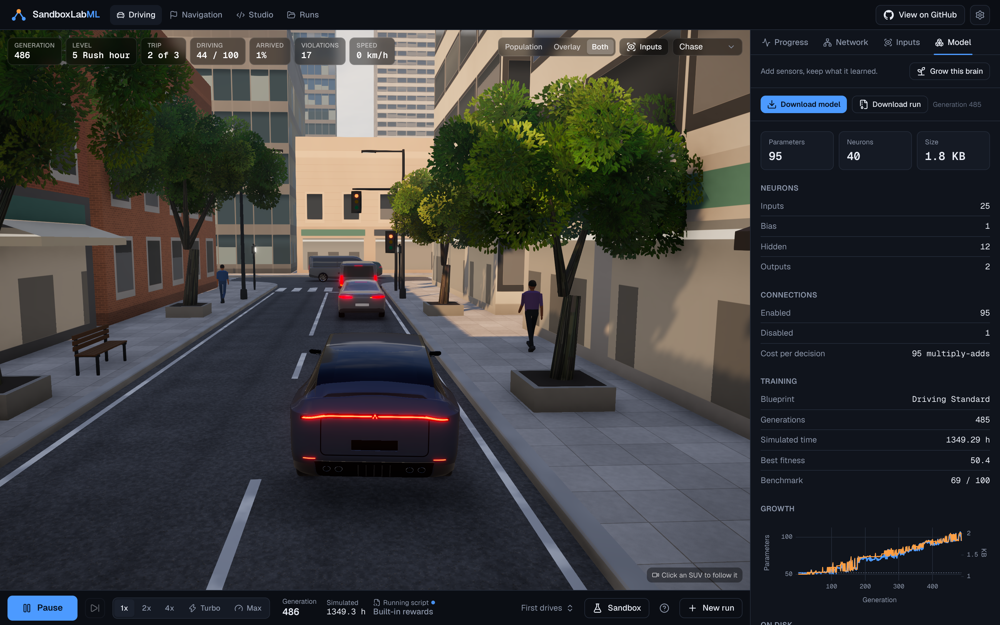 | 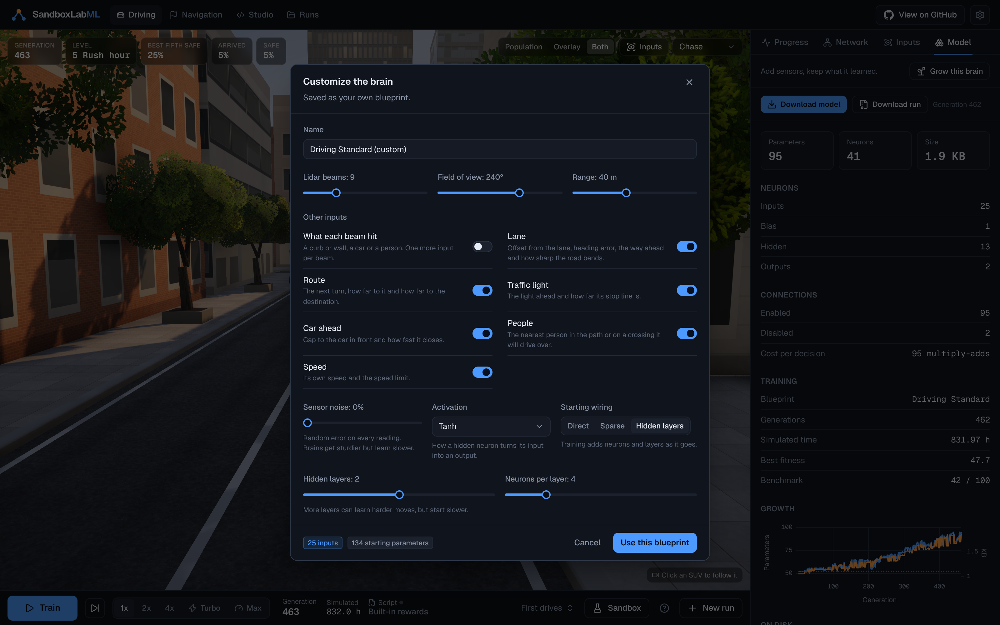 |

## What you can do

### Learn as you go

The first time you open a lab, a short walkthrough points at each part and explains it in plain words: how the agents learn and how a trained brain decides. Skip it anytime, or replay it from the help menu.

### Train an SUV to drive a city

A hundred SUVs share a city with traffic lights, people on the sidewalks and crossings, and other cars. Every SUV drives the same trips, and the best drivers breed the next generation. A curriculum moves them up as they master each level, from empty streets to traffic lights, then people, then other cars, and finally rush hour, with crowds that cross late or away from the crossings. The tires have a real grip limit, so braking and turning share the same grip.

Turn the inputs on to see what the followed SUV senses: its lidar beams, boxes round the cars and people it has detected, the light it is reading with the line it means to stop at, the route ahead drawn on the road and arrows where it will be over the next few seconds. The chase camera follows the leading SUV on its own springs, so it stays smooth when a car twitches or the lead changes hands. You can also watch from an orbit, a street corner, top down or a free camera.

### Train runners to reach the finish

A hundred runners start on a straight empty run to a finish line. Once the best of them finish three quarters of their courses, the next level arrives: one crate, then a field of crates, rows of spikes, walls with narrow gaps, crates that slide back and forth, and the Gauntlet, which mixes them all. Every generation runs fresh courses, so the runners learn to navigate rather than memorize a room. The camera follows the best runner. Turn the inputs on to see what it senses: beams to the walls, spikes and movers around it, an arrow toward the finish, and the path hint as a trail of dots along the shortest way round.

### Play with what you trained

Every trained model can leave training and go into the Sandbox. In Driving, pick a city, a level and a trip, or click any street on the map to drive there, then line up to eight champions or copies of a trained model. In Navigation, pick a level, a named course, or draw your own with crates, walls, spikes and movers, then send up to forty runners across it. Both Sandboxes ship a trained model, so there is something skilled to watch before you train anything.

### Write the training loop yourself

Training is driven by a small, safe script language called SBL. Edit it as blocks or as code, since both views edit the same script. Each lab comes with three preset scripts (Beginner, Intermediate and Advanced), docs, autocorrect and a test run that plays one episode and replays it tick by tick. Thirteen guided lessons across both labs teach it step by step beside a live preview. The lab toolbar always names the script a run is training with.

### Take your model with you

The Model tab downloads the champion brain as a `.model.json` file: every neuron and link with its weight, the names of its inputs and outputs, and the order to evaluate them in. That is enough to run it in any language. The same tab downloads the whole run, which imports back into the app on the Runs page.

### Tune everything

Population size, brain shape, sensors, sensor noise, rewards and training speed are all yours to set. A brain can start wired straight from inputs to outputs or through up to three hidden layers, and training adds neurons and layers as it needs them. The Network tab shows how many layers deep the champion has grown. Settings in the top right pick the frame rate (30, 60 or Max) and the quality (Low, Medium or High). Drag the divider between the 3D view and the panel to give either side more room.

## Why you can trust what you see

* **Real neuroevolution.** Brains evolve with NEAT, which starts from tiny networks and grows them. Mutations add links and neurons, and speciation protects new ideas long enough to improve.
* **Real rules.** The SUV has a grip limit, lights cycle on a plan, people cross when the signal lets them, and other cars keep their lanes and stop at red. A runner has a speed and a turn rate and slides along walls. Nothing bends the rules for a brain.
* **Fully reproducible.** Every random number is seeded and every weight is stored exactly. Replays are re-simulated from stored brains instead of recorded video, and tests check that a replay matches its training run tick for tick.
* **Benchmarked.** A built-in benchmark scores any champion in cities and courses it never trained on, next to reference curves trained from several seeds, so you can tell real learning from luck. See [docs/benchmark.md](docs/benchmark.md).
* **Private by default.** Everything runs locally in Web Workers. Runs are saved in your browser and can be exported as a file to share.

## How it works

* **Simulate lean, render rich.** Both labs simulate in 2D at 30 Hz. The SUV is a kinematic bicycle model on a street grid. A runner is a small body that moves, turns and slides. The renderer only reads snapshots and interpolates them, so quality settings never change a training result.
* **One pipeline, two labs.** Driving and Navigation plug into the same training, replay, storage, benchmark and lesson code. A new environment is a set of modules plus one entry per layer.
* **Threads.** A coordinator worker runs evolution, sim workers run episodes on every spare core, and a replay worker drives ghosts and the Sandbox. Snapshots stream to the renderer as transferable buffers.
* **Live networks.** The network graph draws every neuron and link of the current champion and lights them with real activations each tick. A model card tracks parameters and size as the brain grows.
* **Scripts are data.** SBL is parsed, checked against an API registry (names, units and scopes) and compiled into closure trees. Nothing ever evaluates generated JavaScript, so an imported run cannot carry code that runs on open.

More detail lives in [docs/architecture.md](docs/architecture.md) and [docs/benchmark.md](docs/benchmark.md).

## Getting started

You need Node.js 20.9 or newer (22 is what CI uses).

```bash
git clone https://github.com/edison16a/SandboxLabML.git
cd SandboxLabML
npm install
npm run dev
```

Open http://localhost:3000. To try the production build locally:

```bash
npm run build
npm start
```

### Deploy to Vercel

The app is a standard Next.js project with no server code or environment variables. Import the repository in Vercel, keep the detected Next.js settings, and deploy.

## Development

| Command | What it does |
| --- | --- |
| `npm run dev` | Development server with hot reload |
| `npm run lint` | ESLint |
| `npm run typecheck` | TypeScript, strict |
| `npm test` | Vitest unit tests for the engine, workers, storage and logic |
| `npm run e2e` | Playwright browser tests (run `npm run build` first) |
| `npm run format` | Prettier |
| `npm run refs` | Retrains the benchmark references and the Sandbox models (`-- --env driving` or `navigation` for one lab) |
| `npm run icons` | Re-renders the PNG app icons from the SVG |
| `npm run hero:driver` | Trains the SUV the landing page shows and picks its trips |
| `npm run hero:navigator` | Trains the runner the landing page shows and picks its courses |
| `npm run hero:poster` | Captures the landing page posters from the live scenes (needs a running build) |

### Project layout

```
app/               Next.js routes (landing, the two labs, Studio, Runs)
src/engine/        Pure TypeScript: NEAT, the env pipeline, Driving, Navigation, SBL, benchmarks, lessons, the hero loops
src/workers/       Coordinator, sim and replay workers, plus the main thread client
src/render/        React Three Fiber scenes: the city and the SUV, the courses and runners, the hero stage
src/features/      Lab pages, Sandboxes, charts, network graph, model card, runs, landing, walkthroughs
src/studio/        Script Studio
src/storage/       IndexedDB (Dexie): runs, generations, checkpoints, scripts, blueprints, courses
src/ui/            Design system on Radix primitives, loading states, the walkthrough engine, logo and GitHub button
content/lessons/   Lesson content for both labs
scripts/           Reference, hero and poster generators
public/references/ Benchmark reference curves and the Sandbox models
public/hero/       The landing page's trained brains and its poster stills
```

### Stack

Next.js 16, React 19, TypeScript, Tailwind CSS 4, three.js with React Three Fiber, drei and postprocessing, Comlink, Zustand, Dexie, uPlot, CodeMirror 6, Vitest and Playwright.

## License

MIT, see [LICENSE](LICENSE).
